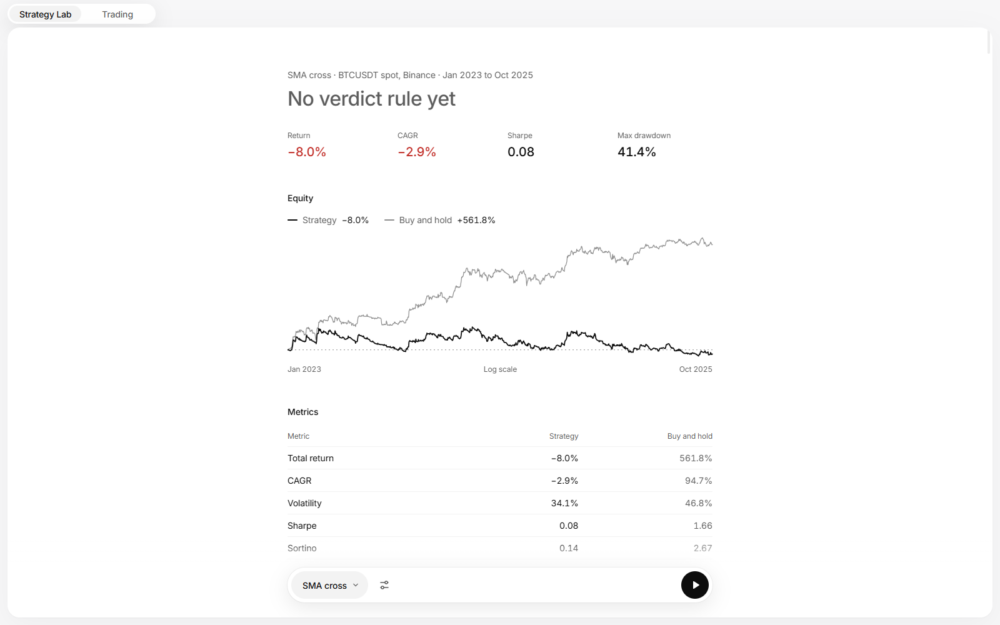
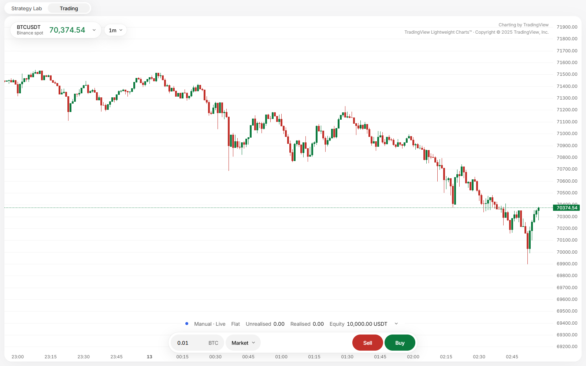
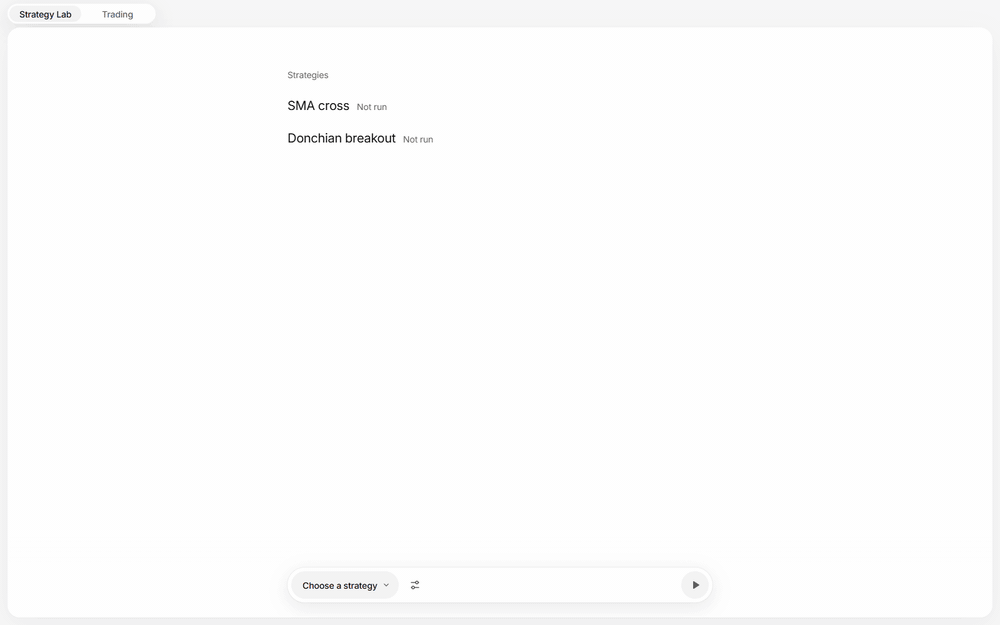

# Trading Desk

Trading Desk is the workspace I use for my own trading: a desktop app that backtests trading strategies on historical market data and paper-trades the same strategy code on live prices. It is one Electron app with two sections on a shared Rust engine. Strategy Lab backtests and tests strategies on historical data; Trading shows live charts and paper-trades the same strategy code. It covers crypto spot and perpetual futures on Binance and Bybit, live and historical, and historical FX pairs from OANDA.





Choosing a strategy in Strategy Lab and running it, through to the result. The wait while the run loads the data is shown at double speed.



## Status

Backtesting and paper trading only. The app never sends a real order to any exchange, and nothing in it is financial advice. It is a personal project that changes often.

## Building and running

You need:

- the Rust toolchain named in `rust-toolchain.toml` (rustup installs it on the first build),
- Node 24 and pnpm 10.

Then, from `gui/`:

- `pnpm install` installs the GUI workspace.
- `pnpm dev` builds the engine optimised (`cargo build --release -p td-server --bin td-server`) and opens the app with hot reload. The first build takes several minutes; later ones rebuild only what changed.
- `pnpm build` makes the production bundle in `app/out`, and `pnpm test` runs the GUI tests.

The engine's own tests run with `cargo test --workspace` from the repository root. `gui/README.md` has the rest of the GUI commands, including the screenshot and UI checks.

### Installing

There is an installer for Windows: download `Trading.Desk.Setup.<version>.exe` from the latest [GitHub release](https://github.com/GabrielEzerzer/trading-desk/releases/latest). To build it yourself, run `pnpm dist` from `gui/`, which builds the engine, the app and the installer and writes `gui/app/dist/Trading Desk Setup <version>.exe`. The installer ships the engine built from your checkout, so if `crates/td-engine/src/strategies/private/` exists, your private strategies are compiled into it: do not share an installer built that way. Release installers are built from a clean checkout with no private folder.

The installer installs the app for the current Windows user only, so it needs no administrator rights. It puts the app, with the engine beside it, in `%LOCALAPPDATA%\Programs\trading-desk`, and adds a Start menu entry and a desktop shortcut. The installer is not signed, so the first time it runs Windows SmartScreen says it protected your PC; choose "More info", then "Run anyway". The app does not update itself: to update, run a newer installer.

The installed app keeps downloaded market data and saved runs in the data folder described under "Market data" below, `%LOCALAPPDATA%\trading-desk` unless `TD_DATA_DIR` is set, and creates what it needs there on first use. Its browser profile (caches and local storage) is in `%APPDATA%\Trading Desk`. For FX downloads, the app needs `OANDA_API_TOKEN` in its own environment. Set it only for the app's process. In PowerShell, run `$env:OANDA_API_TOKEN = [Net.NetworkCredential]::new('', (Read-Host 'OANDA token' -AsSecureString)).Password` and paste the token, which is not shown. Then start the app from that same window with `& "$env:LOCALAPPDATA\Programs\trading-desk\Trading Desk.exe"`, or start it through your secrets manager. Do not save the token as a persistent user environment variable (with `setx` or the Settings dialog): every program you start afterwards would get it, including the build scripts of every crate and npm package you build.

Uninstall it from Settings > Apps > Installed apps. Uninstalling removes the app but leaves both folders, so your data is still there after a reinstall. To remove the data as well, delete `%LOCALAPPDATA%\trading-desk` and `%APPDATA%\Trading Desk` after uninstalling.

### Market data

The app needs candles before it can backtest. Download them with the `td-data` command line tool, for example two years of one-minute BTCUSDT spot candles from Binance:

```
cargo run --release -p td-data -- download --venue binance --kind spot --symbol BTCUSDT --from 2023-01-01 --to 2025-01-01
```

A download skips a month that is already stored with no minute missing, so running it again over the same range fetches only what is missing. The `instruments` subcommand lists what a venue has open for trading, and keeps the list in the data folder for a day; `stored` lists what you have downloaded and how much space it takes, and `delete` removes it. Strategy Lab can also download the history a strategy needs from inside the app, and a backtest whose range is not all stored downloads the missing part first, as a step of the same run.

In the app, Strategy Lab's "Stored data" view, at the foot of the strategy list, shows the data folder, its size and each instrument's months, and deletes one instrument, a range of its months or all market data; saved runs and paper sessions stay.

The data folder is `TD_DATA_DIR` when that environment variable is set. Otherwise it is `%LOCALAPPDATA%\trading-desk` on Windows, and `$XDG_DATA_HOME/trading-desk` or `~/.local/share/trading-desk` elsewhere. It lives outside the repository, and market data is never committed.

### Data sources

Crypto prices come from Binance and Bybit public market data, which needs no account: Binance's monthly archives on data.binance.vision, both venues' public REST APIs and their public live streams. FX pairs come from OANDA, which needs the API token of a free OANDA practice account in the `OANDA_API_TOKEN` environment variable. I keep mine in my secrets vault and start the tools through it, but any way of setting the environment variable works.

### FX history from OANDA

FX pairs (`--venue oanda --kind fx`) download bid and ask minutes from OANDA's REST API on a free practice account, from 2007 on. The desk's FX market hours follow the US daylight-saving rule in force since 2007, so the app refuses an earlier start; the CLI does not check it, so keep `--from` at 2007-01-01 or later. The download reads the account's API token from `OANDA_API_TOKEN`. Build first, then run the built program with the variable set, so the token is not in the environment of the build scripts cargo runs. Reading the token from a hidden prompt, as below, keeps it out of your shell history:

```
cargo build --release -p td-data
read -rs -p 'OANDA token: ' OANDA_API_TOKEN && echo
OANDA_API_TOKEN="$OANDA_API_TOKEN" target/release/td-data download --venue oanda --kind fx --symbol USDJPY --from 2016-01-01 --to 2026-11-01
```

A request returns at most 5,000 minutes, so a month of one pair takes six or seven requests. A minute with no price is filled at the last close, with volume 0; most such minutes fall around the New York close. A run of an hour or more with no price is left missing, and nothing is stored for the weekend, when the market is closed. The download records the spans OANDA returned nothing for in a `.closed.json` file beside the month; the first download of a month fetches all of it, so its record covers the whole month. A recorded span counts as closed if it holds at most 4 hours of open time, such as a late Sunday open, or at most 27 hours and overlaps the year-end holidays, 24 December to 2 January UTC, such as the 24 to 25 December closure, which runs a little over a day. A closed span is not a gap in coverage or in a run's data report, which lists it under `closures`. Any other recorded span is an outage. It stays a gap, and the month is not complete, so the next download over it fetches it again. A backtest is refused over a day or more of missing open time in a month with a record. A month downloaded before these records existed has none, so its holidays still show as gaps, and a backtest is refused only at two days of missing open time there. Download the month again to record its closures.

### Holding back recent data

To keep the latest months unseen while you work on a strategy, start the engine with `TD_DATA_CUTOFF` set to a UTC date written `YYYY-MM-DD`, for example `TD_DATA_CUTOFF=2026-06-30`. While it is set, every backtest, sweep, out-of-sample run, walk-forward run and test battery whose range ends after the end of that date is refused with an error that names the cutoff, before any bar is read. A range that ends at midnight UTC at the end of the cutoff date is allowed. Paper trading and the live chart are not affected.

The cutoff is shown in one place on the server, `GET /health` (`data_cutoff`), and the app shows it while it is in force. Each run saved under a cutoff records it, and `GET /runs/{id}` returns it as `data_cutoff`. A value that is not a real date, an empty one included, stops the engine at start with an error. Runs saved before the cutoff was set still open in full, held-back months included. For the final check on the held-back months, start the engine without the variable.

## Writing a strategy

A strategy is one Rust file with three parts. `crates/td-engine/src/strategies/sma_cross.rs` is the example to copy.

1. **The strategy.** An `entry()` function gives its name, a description and its parameters, and a struct implements the `Strategy` trait. Its `Context` gives it its instrument's bars up to the one that just closed, its account and orders, and on a perpetual the funding rates settled so far (`Context::funding`): each rate with its time, oldest first, from its first warm-up bar's open up to but not including the current bar's close. Funding is charged from the first traded bar on; the rates before it are history only. A paper session gives the venue's rates from its first warm-up bar. A market without funding has none.
2. **The test plan** (`TestPlan`). It names the instruments, the timeframe and the period to test on, the backtest settings (starting cash, leverage cap, a slippage for any instrument that should not take the backtest's default of 2 bps on BTC and ETH and 5 bps elsewhere, the account currency, which is the quote currency unless the plan names the base, as a dollar account trading USD/JPY does, and an optional `fee_override` that every run pays in place of the instrument's own fees, such as a broker's commission per unit of an FX pair), the parameter grid to sweep, the walk-forward window lengths and an optional single out-of-sample split. The `evidence` field holds the common evidence tests from #35. Leave it at `EvidenceSettings::default()` unless the strategy needs stricter values. A plan can make these tests stricter. The one value it can lower is the permutation count, down to 49 for a quicker run. It cannot switch any test off or loosen any other value, and the plan is refused if it tries.

   The battery runs the same tests on every market, keyed on what the market's rules say it can do rather than on its name. On a market with quotes, such as FX, the luck test rebuilds each shuffled bar's ask with the spread of the bar that stood at that time, so a strategy that trades only in a tight-spread hour pays that hour's spread on every shuffled copy too, and the cost stress widens each bar's spread by the same multiple it applies to fees, the per-unit commission and slippage. The parameter plateau is judged out of sample: in each walk-forward window, the neighbours on the grid of the set the window chose run on that window's test bars, and each is compared with the walk-forward's own runs in the windows where it ran. When a market charges a financing cost the engine does not model yet, such as the FX overnight swap, and a trade holds a position through the point where it is charged, the verdict carries a warning naming that cost.
3. **The verdict rule** (`VerdictRule`). It is one of three kinds. `PropFirm` takes the firm's daily-loss and drawdown limits and its profit target, and optionally a second phase's target (`second_target`), a minimum number of trading days per phase (`min_trading_days`), a best-day rule (`best_day_share`), a day cap (`day_target_share`) and the level a trailing floor stops rising at (`trailing_floor_lock`), and where the firm's day ends (`day_rollover`, midnight UTC with an offset in minutes or 17:00 New York). The day cap limits what one day counts toward an evaluation phase's target to a share of that target: a winning day counts its profit up to the cap, a losing day counts its whole loss, and the phase passes once the counted profit reaches the target, while the loss limits still act on the account's real balance. A trading day is a day with a fill, unless the firm's own test (`trading_day`) is set: it can ask for a fill that closes a trade (`needs_close`), for the closed part to be worth at least a share of the starting balance (`min_trade_size`, the closed quantity at the average entry price, judged at the size the strategy was tested at, on each walk-forward test window's own fills rather than the stitched ones that carry the stitched curve's level, so it cannot be set with `attempt` terms traded at another size), and for it to have moved at least a share of that value before fees (`min_trade_move`). Each closing fill is judged on its own, and the same days count toward the minimum per phase and the wait before the first payout. The fill that closes what a walk-forward test window still holds at its end marks no trading day, with or without a test, since the strategy did not choose it; the fills that reopen a position at the start of the next window still count, which a strategy that holds across windows would not have made. The odds in the battery's result say how many of the out-of-sample days counted as trading days. Its limits set how many days the pass odds and the breach odds are simulated over (`pass_horizon_days` and `breach_horizon_days`, 90 each by default), so a challenge with no time limit can set a longer pass horizon. A path simulated for the breach odds starts each phase again at the account size when the phase before it passes, and after the last phase passes it trades on as the funded account, again from the account size with a fresh floor, as a firm starts each new account. That funded account takes no payouts, so for a funded account that pays out as early as it can, which brings the balance back towards the floor, the breach odds are understated. Each simulated day brings its close-to-close return and its lowest equity inside the day, both from the same past day (the firm's days when `day_rollover` is set, UTC days otherwise), and the daily loss limit and the maximum loss are checked on that low, since firms usually watch equity at every moment: a day that dips through a limit and closes back above it ends the attempt. A day's low is checked against the trailing floor that the closes before it set, as a firm that trails its floor on daily closes checks it. When the run has no equity inside its bars, the limits are checked at daily closes instead, and the odds lines of the verdict say so. The kind's worst-daily-loss line measures the firm's day when `day_rollover` is set, and otherwise the worse of days ending at midnight UTC and at 17:00 New York. It reads each day's fall inside bars as a share of that day's starting balance, as an attempt started that morning would see it, rather than as a share of the starting cash on a curve that compounds from one test window to the next. This assumes the position size grows with the balance, so when the line passes but the worst day's fall as a share of the starting cash is over the limit, the verdict carries a warning with both figures. Its drawdown line reads the worst attempt of `breach_horizon_days` days started on any day of the test, each starting again from its own balance (and from its own peak for a trailing drawdown), as a fraction of that balance and inside bars, rather than the whole test as one account that is never reset. With a trailing drawdown and `trailing_floor_lock`, each attempt's peak counts only up to where its floor reaches the lock, so the line measures the fall to the floor the firm applies, as the simulated attempts do. Judging each fall against the attempt's own starting balance assumes the position size grows with the balance, as in the simulated attempts, so when the line passes but the worst attempt's fall as a share of the starting cash, which is what a strategy that trades a fixed quantity or notional set from the starting cash would lose, is over the limit, the verdict carries a warning with both figures. The rule's optional `attempt` terms (`AttemptTerms`: account size, fees, the funded account's payout rules and horizon, the size traded in each, and a reduced-edge factor) make the battery price one attempt in money, and add a line that asks for the attempt to be worth more than zero with the mean daily return scaled by that factor. A negative mean is left as it is, so the reduction never makes a losing strategy look as if it loses less. The first payout waits for `days_to_first_payout` trading days and, when `calendar_days_to_first_payout` is set, also for that many calendar days counted from the funded account's first trading day; both waits must be met. The result also carries the value with the whole mean removed, on the same draws, which no line judges: a positive value there means the terms pay for an attempt with no edge at all, so a positive value at the reduced edge does not show that the edge is what makes the attempt worth buying. With a negative mean, that value reads better than the value at the full edge, since it removes a loss rather than reducing an edge. `Portfolio` is judged against `BuyAndHold` or `Cash`. `HighRisk` is judged on expectancy and risk of ruin. Each kind's limits default to #35's values. To change a single limit, name that field and fill the rest from the default, for example `PortfolioLimits { min_sharpe: 1.5, ..PortfolioLimits::default() }`.

A strategy can also read the closed bars of other instruments on the same venue, its reference instruments, with `Context::reference(&id)`. A run names them in `references` in its configuration (a backtest, or the base of a sweep, an out-of-sample run or a walk-forward run); a test battery names them in the plan request's `references` (`POST /runs/plan`), not in the `TestPlan`. The slice holds one slot for each bar the strategy has seen, warm-up included, in the same order: the reference bar that opened and closed with that bar, or `None` where the reference has no bar. A missing bar is never filled with the one before it, and nothing later than the strategy's current bar is in the slice. References are read-only: orders, fills, fees and the account stay on the traded instrument. They are saved in the run's configuration and its data fingerprint, the data cutoff covers them, and the luck test shuffles them with the traded bars under one permutation; the cost stress widens the traded instrument's spread only. The strategy reads each reference's bid bars. A run does not download a reference instrument: the store must already hold its bars over the run's range, or the run is refused with the span to download. A paper session cannot feed reference instruments yet, so `Context::reference` returns `None` in one; a session is not started from a verdict judged with references: naming one is refused, and so is a start that names none when the strategy's latest verdict on the instrument used them (name a verdict judged without them instead). A strategy that needs a reference should stop with `Context::fail` when it has none.

A backtest fills orders from bars alone; `CandleFillModel` in `crates/td-engine/src/fill.rs` states every rule. On a market with quotes, buys fill on the ask bars and sells on the bid bars. A market order fills at the next bar's open, moved against it by the slippage. A stop fills where the bar reaches its trigger, or at the open when the bar opens past it, with slippage. A limit order rests from the close it was decided on and fills at its own price, as a maker, once a bar's range reaches that price; when a bar opens through it, it fills at its limit, not at the better open. A limit that was already marketable when it was sent takes liquidity at the next open instead, with slippage but never past its limit. A resting limit fills in full, at its own price, even when the bar only touches the price: there is no queue. On a real book an order whose price is touched and not traded through fills only as far as its place in the queue allows, so this flatters a strategy that rests limits. The battery's breakdown reports how many of the out-of-sample fills were resting limits' (`limit_fills`) and how many of those the bar only touched, without trading at least one tick through the price (`touch_only_fills`), so a reader can see how many of the fills behind a result a real book might not have given. They are counts of fills, not a share of the profit: one such fill can carry much of a result, and a rule that asked for a trade through the price would delay some of these fills to a later bar rather than remove them.

Each saved verdict says what it was judged on, so a strategy tested over many runs cannot look better than it is. `GET /verdicts` lists, for each strategy and instrument:

- `code_matches`: whether the strategy's source file is the same as when the battery ran. The build hashes each strategy's own file, examples and private ones alike, and every run saves that hash. A run saved before hashes were recorded shows `null`, meaning unknown. The hash covers the strategy's own file only. Any other file it uses, a shared helper or a file of its own pulled in with `#[path]` or `include!`, is not hashed, so a change to that file alone leaves `code_matches` true.
- `stale`: true unless the engine, the plan and rule, and the code all still match.
- `loosened`: every limit of the verdict's rule that is looser than its kind's default, with both values. A lower minimum or a higher maximum is looser; a longer pass horizon and a shorter breach horizon are looser too. Tightened limits are not listed.
- `runs` and `code_versions`: how many batteries have run on the pair, and how many distinct versions of the code they ran. Both are keyed by the strategy's name, so a renamed strategy starts again from zero.

A private strategy goes in `crates/td-engine/src/strategies/private/`. Git ignores that folder, so it can hold your own strategies, or a checkout of a separate private repo of them (`git clone <url> crates/td-engine/src/strategies/private`). Every `*.rs` file in it is compiled in by `crates/td-engine/build.rs` and listed after the examples. Nothing else needs editing, and the engine builds without the folder. A file name must be a Rust module name, such as `my_strategy.rs`, and not a Rust keyword such as `mod.rs` or a bare `_.rs`. An example strategy in this repo also needs a `pub mod` line in `strategies/mod.rs` and an entry in `registry.rs`.

`cargo test -p td-engine` checks every registered strategy's plan and rule, including the private ones when the folder is present.

## Checks

CI runs rustfmt, clippy with warnings denied, the workspace tests, a check that the generated TypeScript API types are up to date, and the benchmark. The benchmark step runs `td-bench` in release mode on its synthetic data and compares each split's results checksum with the value in `harness/evals/perf-checksums.txt`; it ignores the timings, which are too noisy on shared runners. The checksum leaves out the engine revision, so a revision bump alone does not move it. A change that means to move results updates that file in the same PR, beside the `ENGINE_REVISION` bump in `crates/td-engine/src/runner.rs`. To measure the values, run `cargo run --release -p td-server --bin td-bench -- --split dev --reps 1` and read `checksum=` on the `BENCH` line.

## License

Trading Desk is licensed under the GNU General Public License, version 3 only (GPL-3.0-only). See [LICENSE](LICENSE).
