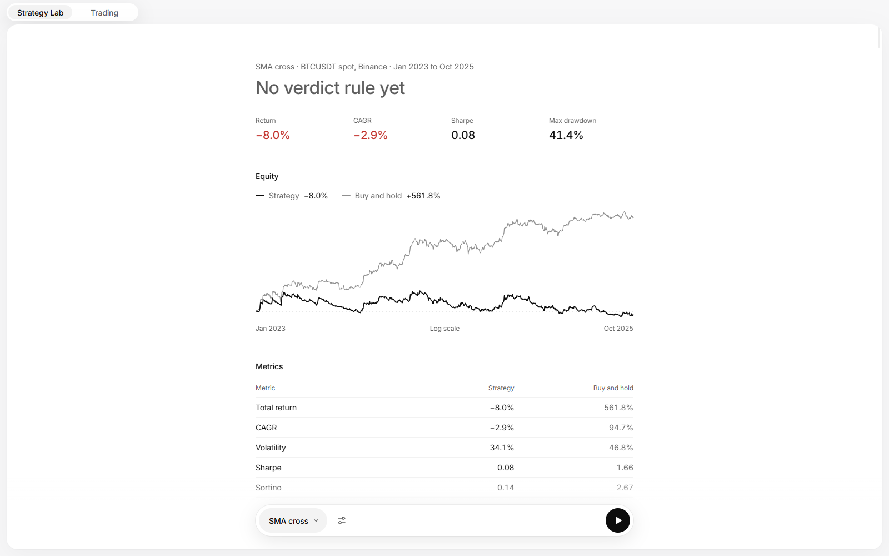
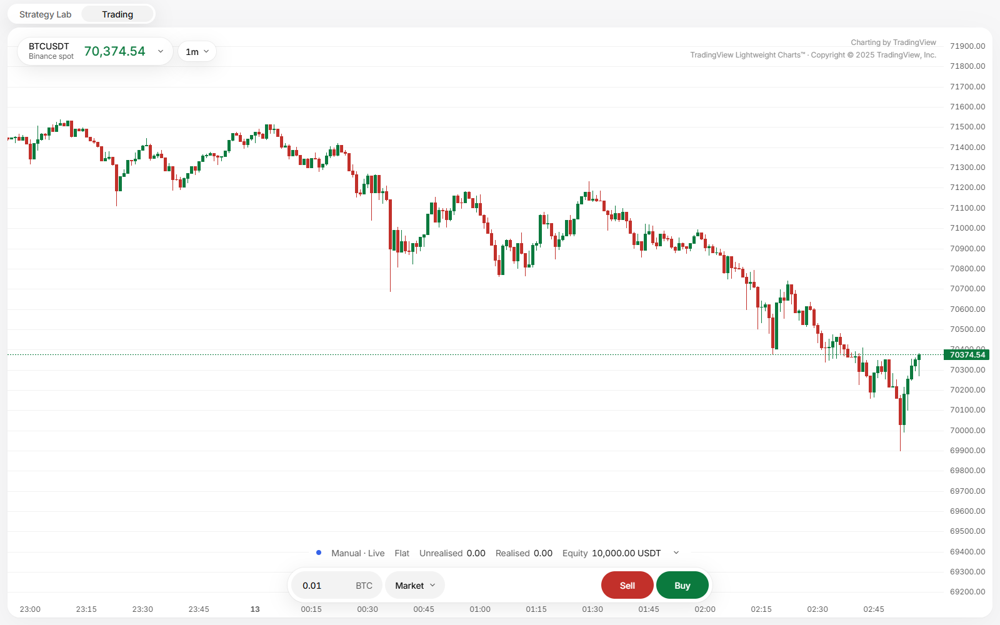
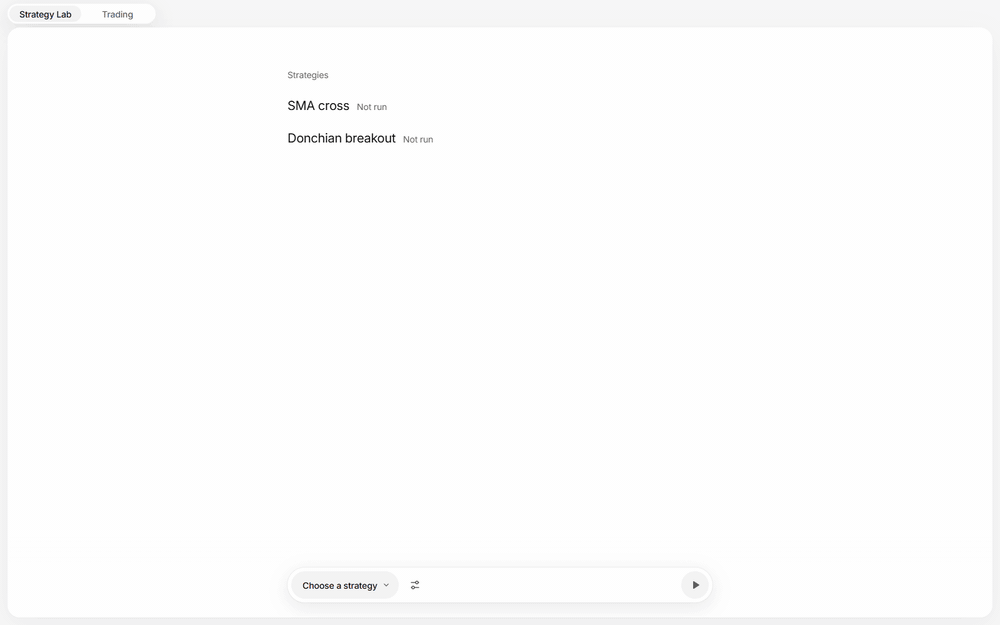

# Trading Desk

Trading Desk is the workspace I use for my own trading: a desktop app that backtests trading strategies on historical market data and paper-trades the same strategy code on live prices. It is one Electron app with two sections on a shared Rust engine. Strategy Lab backtests and tests strategies on historical data; Trading shows live charts and paper-trades the same strategy code. It covers crypto spot and perpetual futures on Binance and Bybit, live and historical, historical FX pairs from OANDA, and daily bars of US stocks and ETFs from Alpaca.





Choosing a strategy in Strategy Lab and running it, through to the result. The wait while the run loads the data is shown at double speed.



## Status

Backtesting and paper trading only. The app and its sidecar never send an order; the `td-live` command sends orders only to a venue's demo-trading environment, never to a real-money endpoint, and that is fixed in code. Nothing in it is financial advice. It is a personal project that changes often.

## Building and running

You need:

- the Rust toolchain named in `rust-toolchain.toml` (rustup installs it on the first build),
- Node 24 and pnpm 10.

Then, from `gui/`:

- `pnpm install` installs the GUI workspace.
- `pnpm dev` builds the engine optimised (`cargo build --release -p td-server --bin td-server`) and opens the app with hot reload. The first build takes several minutes; later ones rebuild only what changed.
- `pnpm build` makes the production bundle in `app/out`, and `pnpm test` runs the GUI tests.

The engine's own tests run with `cargo test --workspace` from the repository root. `gui/README.md` has the rest of the GUI commands, including the screenshot and UI checks.

### Installing

There is an installer for Windows: download `Trading.Desk.Setup.<version>.exe` from the latest [GitHub release](https://github.com/GabrielEzerzer/trading-desk/releases/latest). To build it yourself, run `pnpm dist` from `gui/`, which builds the engine, the app and the installer and writes `gui/app/dist/Trading Desk Setup <version>.exe`. The installer ships the engine built from your checkout, so if `crates/td-engine/src/strategies/private/` exists, your private strategies are compiled into it: do not share an installer built that way. Release installers are built from a clean checkout with no private folder.

The installer installs the app for the current Windows user only, so it needs no administrator rights. It puts the app, with the engine beside it, in `%LOCALAPPDATA%\Programs\trading-desk`, and adds a Start menu entry and a desktop shortcut. The installer is not signed, so the first time it runs Windows SmartScreen says it protected your PC; choose "More info", then "Run anyway". The app does not update itself: to update, run a newer installer.

The installed app keeps downloaded market data and saved runs in the data folder described under "Market data" below, `%LOCALAPPDATA%\trading-desk` unless `TD_DATA_DIR` is set, and creates what it needs there on first use. Its browser profile (caches and local storage) is in `%APPDATA%\Trading Desk`. For FX downloads, the app needs `OANDA_API_TOKEN` in its own environment. Set it only for the app's process. In PowerShell, run `$env:OANDA_API_TOKEN = [Net.NetworkCredential]::new('', (Read-Host 'OANDA token' -AsSecureString)).Password` and paste the token, which is not shown. Then start the app from that same window with `& "$env:LOCALAPPDATA\Programs\trading-desk\Trading Desk.exe"`, or start it through your secrets manager. Do not save the token as a persistent user environment variable (with `setx` or the Settings dialog): every program you start afterwards would get it, including the build scripts of every crate and npm package you build.

Uninstall it from Settings > Apps > Installed apps. Uninstalling removes the app but leaves both folders, so your data is still there after a reinstall. To remove the data as well, delete `%LOCALAPPDATA%\trading-desk` and `%APPDATA%\Trading Desk` after uninstalling.

### Market data

The app needs candles before it can backtest. Download them with the `td-data` command line tool, for example two years of one-minute BTCUSDT spot candles from Binance:

```
cargo run --release -p td-data -- download --venue binance --kind spot --symbol BTCUSDT --from 2023-01-01 --to 2025-01-01
```

A download skips a month that is already stored with no minute missing, so running it again over the same range fetches only what is missing. Beside each month it downloads, it records in a `.closed.json` file the spans of the range it asked for that the venue returned nothing for, apart from a span that reaches the present, whose minutes may only not be published yet, and, for crypto, a span at the end of the range that ends less than a day before the present, since a day's history file can come out the day after. For crypto, a month the venue had nothing for at all, such as one before an instrument was listed, is stored as that record alone, with no candles; `stored` lists it and `delete` removes it like any other month, and the next download over it asks for it again. For FX, such a month gets no record. The `instruments` subcommand lists what a venue has open for trading, and keeps the list in the data folder for a day; `stored` lists what you have downloaded and how much space it takes, and `delete` removes it. Strategy Lab can also download the history a strategy needs from inside the app, and a backtest whose range is not all stored downloads the missing part first, as a step of the same run.

In the app, Strategy Lab's "Stored data" view, at the foot of the strategy list, shows the data folder, its size and each instrument's months, and deletes one instrument, a range of its months or all market data; saved runs and paper sessions stay.

The data folder is `TD_DATA_DIR` when that environment variable is set. Otherwise it is `%LOCALAPPDATA%\trading-desk` on Windows, and `$XDG_DATA_HOME/trading-desk` or `~/.local/share/trading-desk` elsewhere. It lives outside the repository, and market data is never committed.

### Data sources

Crypto prices come from Binance and Bybit public market data, which needs no account: Binance's monthly archives on data.binance.vision, both venues' public REST APIs and their public live streams. FX pairs come from OANDA, which needs the API token of a free OANDA practice account in the `OANDA_API_TOKEN` environment variable. US stocks and ETFs come from Alpaca's market data API, which needs the key pair of a free Alpaca account in `APCA_API_KEY_ID` and `APCA_API_SECRET_KEY`. I keep mine in my secrets vault and start the tools through it, but any way of setting the environment variable works.

### FX history from OANDA

FX pairs (`--venue oanda --kind fx`) download bid and ask minutes from OANDA's REST API on a free practice account, from 2007 on. The desk's FX market hours follow the US daylight-saving rule in force since 2007, so the app refuses an earlier start; the CLI does not check it, so keep `--from` at 2007-01-01 or later. The download reads the account's API token from `OANDA_API_TOKEN`. Build first, then run the built program with the variable set, so the token is not in the environment of the build scripts cargo runs. Reading the token from a hidden prompt, as below, keeps it out of your shell history:

```
cargo build --release -p td-data
read -rs -p 'OANDA token: ' OANDA_API_TOKEN && echo
OANDA_API_TOKEN="$OANDA_API_TOKEN" target/release/td-data download --venue oanda --kind fx --symbol USDJPY --from 2016-01-01 --to 2026-11-01
```

A request returns at most 5,000 minutes, so a month of one pair takes six or seven requests. A minute with no price is filled at the last close, with volume 0; most such minutes fall around the New York close. A run of an hour or more with no price is left missing, and nothing is stored for the weekend, when the market is closed. The download records the spans OANDA returned nothing for in a `.closed.json` file beside the month; the first download of a month fetches all of it, so its record covers the whole month. A recorded span counts as closed if it holds at most 4 hours of open time, such as a late Sunday open, or at most 27 hours and overlaps the year-end holidays, 24 December to 2 January UTC, such as the 24 to 25 December closure, which runs a little over a day. A closed span is not a gap in coverage or in a run's data report, which lists it under `closures`. Any other recorded span is an outage. It stays a gap, and the month is not complete, so the next download over it fetches it again. A backtest is refused over a day or more of missing open time in a month with a record. A month downloaded before these records existed has none, so its holidays still show as gaps, and a backtest is refused only at two days of missing open time there. Download the month again to record its closures.

### US stocks and ETFs from Alpaca

US stocks and ETFs (`--venue alpaca --kind stock`) download daily bars from Alpaca's market data API (`/v2/stocks/{symbol}/bars`, consolidated SIP feed), from 2016 on. The `instruments` subcommand lists every US stock and ETF in Alpaca's assets list, active or delisted (`/v2/assets?status=all&asset_class=us_equity`, read from the paper trading API, `paper-api.alpaca.markets`), kept for a day as the other venues' lists are; a list with no stock in it is refused and not kept, and a symbol with a dot, such as BRK.B, is left out. Alpaca serves bars for some companies its list does not hold (LLTC, SYMC and YHOO, for three), so a symbol missing from the list still downloads; when the store then holds no bar of it from any download, the download is refused with a message that Alpaca lists no such stock and serves no bars for it, and the days it asked for are still recorded as empty. The store keeps history by symbol: bars that come back under the symbol asked for show the ticker matches, not that it is the same company throughout, so a reused ticker or a mapping error on Alpaca's side is not caught, and choosing a universe as it stood on a past date is up to the caller. So a download of a symbol Alpaca neither lists nor serves, a typo for one, makes one bars request per month and is then refused, and it leaves an adjustment record, which the stored-data list (`GET /data/stored`, or `td-data stored`) does not show, and a record of each empty month, which that list shows under the symbol. Such a stock trades on the rules every Alpaca stock has (kind `stock`, its symbol as base, USD as quote, the same tick, fractional shares and minimum order value, no commission), and a test plan can trade it. Each bars request names the date in New York on the day it is made as its `asof` date, which is Alpaca's default made explicit: a company renamed since is found under its current symbol with its history under the old one (META's bars from before 2022, when it traded as FB), and a delisted symbol keeps its own history. The download reads the key pair from `APCA_API_KEY_ID` and `APCA_API_SECRET_KEY`, sends them only as request headers, and never logs or stores them; a refused key is reported without them. As with OANDA, build first and set the variables only for the built program:

```
cargo build --release -p td-data
read -rs -p 'Alpaca key id: ' APCA_API_KEY_ID && echo
read -rs -p 'Alpaca secret: ' APCA_API_SECRET_KEY && echo
APCA_API_KEY_ID="$APCA_API_KEY_ID" APCA_API_SECRET_KEY="$APCA_API_SECRET_KEY" target/release/td-data download --venue alpaca --kind stock --symbol AAPL --from 2016-01-01 --to 2026-11-01
```

Bars are adjusted for splits and dividends (`adjustment=all`), so a past price is what it would be in today's shares, and the adjustment is recorded in the data folder (`adjustments/alpaca/stock/<SYMBOL>.json`). A download refuses to add bars to a store recorded with another adjustment, or to one that holds bars but no record. Before it downloads, it fetches again the latest month already stored and compares it with the stored bars: a later split or dividend changes every earlier adjusted price, so a difference refuses the download and names the instrument and the first day that moved. Delete the instrument and download it again from the start. The free plan does not serve the latest 15 minutes, so a download stops 15 minutes before the present and keeps only the bars of sessions that closed before then.

Each daily bar is stored as one 1-minute candle at the last minute of its session, 15:59 New York, or 12:59 on an early close, holding the day's open, high, low, close and volume. The desk's US market calendar opens the market for that minute only, on trading days: weekdays other than the NYSE and Nasdaq holidays (New Year's Day, Martin Luther King Jr. Day, Washington's Birthday, Good Friday, Memorial Day, Juneteenth from 2022, Independence Day, Labor Day, Thanksgiving and Christmas; a fixed-date holiday on a Saturday moves to the Friday before and one on a Sunday to the Monday after, except that New Year's Day on a Saturday is not moved) and the market's one-off closures since 2016 (the national days of mourning on 5 December 2018 and 9 January 2025). A closure the exchanges announce later is not in the calendar until it is added. The sessions are 09:30 to 16:00 New York and close at 13:00 on the day after Thanksgiving, and on 3 July and 24 December when they fall Monday to Thursday. So weekends and holidays are never missing data, a 1d bar is one trading day, a 1w bar is the trading days of one week, and coverage, gaps and the run's data report count trading days. A stock runs at 1d or longer, and a shorter timeframe is refused. Each trading day a download asked for and found no bar for is recorded as checked, as for crypto, so a run can tell a day the venue had nothing for from one that was not downloaded. A run is refused when any trading day in its range was never downloaded. A trading day recorded as checked and empty inside a stock's history, as on a trading halt, is no bar for that stock: its orders wait for its next bar, the run goes on, and the run's data report counts these days for each instrument (`days_without_bars`).

A stock traded beside the first may list after the run starts and may stop trading before it ends. When downloads recorded nothing after its last bar, as for a delisted stock, it leaves the run at that bar: a position in it is closed at that bar's close with the run's slippage, its resting orders are cancelled, and later orders for it are refused, which a strategy can see with `ctx.has_left`. Closing at the last close is a convention, not a model of how a delisting settles: it frees the cash at once, at a price only known to be final afterwards, so after a collapse or a halt that never resumes it can overstate what a holder recovers and how soon. The first instrument must trade from the start of the range to its end, so a range it is not listed for yet, or no longer, is refused with the dates that fit it.

A stock or ETF is a cash instrument: no funding, no leverage and, unless the run turns on short sales (below), no shorting, so a buy is refused beyond the cash left after the open buys, and a sell beyond what is held less the open sells it could add to. A plain sell counts every open sell. A reduce-only sell counts only the open sells that are not reduce-only, so a reduce-only stop and a reduce-only take-profit can rest together for the whole holding, as a bracket or OCO pair does at a broker: each is cut to the holding when it fills, so the first to fill closes the position and the other, with nothing left to sell, is cancelled when the market reaches it, without opening a short. A plain sell is cut the same way at fill time to what is held then, and cancelled when nothing is, as a buy is cut to the cash, so no order of fills takes the holding below zero. Unlike a broker's OCO pair, the leftover exit is not cancelled when the first fills: until the market reaches it, it rests and would sell a holding bought meanwhile, and a leftover reduce-only limit the market gapped through with nothing to sell waits for the open, so a market buy filling at that open is sold straight back. Cancel leftover exits before buying again. The same holds for crypto spot. Orders are in fractional shares to 9 decimal places, as Alpaca takes them (<https://docs.alpaca.markets/us/docs/fractional-trading>), with an order value of at least 1 dollar; there is no commission, and the run's slippage is the only cost. A market order decided on a bar fills at the next trading day's open. A test plan's walk-forward days count bars, so on a stock they are trading days, and the minimum sample counts its windows over trading days. Paper and live sessions do not run on stocks: Alpaca has no live stream in the desk.

A backtest can sell stocks short. It is off by default; a run turns it on with `short_stocks` in its config, or in a test plan's `backtest` settings: `"short_stocks": {"shortable": "all", "borrow_rate": 0.01}`, or `{"shortable": {"only": ["SPY", "QQQ"]}}` to name the symbols that can be sold short. A plan or run that sets it must trade only stocks. While it is on, a sell of a stock on the list is no longer limited to the holding: the part of it beyond the holding opens or adds to a short, as a sell does on a perpetual, and a buy covers it. That part is rounded down to whole shares when the order fills, as Alpaca takes no fractional short sale, while buys and sells of a holding stay fractional: holding 0.5 shares, a sell of 2.7 fills 2.5 and leaves a short of 2, and a sell of under one share with nothing held is cancelled at fill time. A short sale of a symbol off the list is refused when it is submitted, with that reason. Alpaca publishes only today's easy-to-borrow flag, not its history, so the list is fixed for the whole run and the caller chooses it. A reduce-only buy covers a short and never turns it long, and `ctx.submit_with_stop` takes a short entry with a buy stop above it, checked over the entry's whole bar as a long entry's stop is.

The short pays a borrow fee at the run's `borrow_rate`, an annual rate, 0 when left out: each calendar day held, at the rate over a 360-day year, on the short's value at the last close. It is charged at the next bar's open for the calendar days since the previous bar, so a short held from Friday to Monday pays three days, and it shows as funding paid, in the trades and the metrics, where a perpetual's funding shows. A short is valued in the leverage cap: while short sales are on, every stock order that is not reduce-only is checked at submission against `max_leverage`, as on a perpetual, with the short counting at its full value. Alpaca's margin rules are not modelled beyond that cap: no maintenance margin (the greater of $5 a share or 30% of the value for a share at $5 or more, and of $2.50 a share or 100% below $5) and no 50% initial margin, so a short is never closed for want of margin. Nor are recalls and forced buy-ins, the short-sale price test of Reg SHO Rule 201, or a hard-to-borrow fee that changes over time. The bars are adjusted for dividends, so a short pays no dividend: the adjustment already lowers the earlier prices.

### Holding back recent data

To keep the latest months unseen while you work on a strategy, start the engine with `TD_DATA_CUTOFF` set to a UTC date written `YYYY-MM-DD`, for example `TD_DATA_CUTOFF=2026-06-30`. While it is set, every backtest, sweep, out-of-sample run, walk-forward run and test battery whose range ends after the end of that date is refused with an error that names the cutoff, before any bar is read. A range that ends at midnight UTC at the end of the cutoff date is allowed. No row of a series (see "Writing a strategy") known after the end of that date is read. Paper trading and the live chart are not affected.

The cutoff is shown in one place on the server, `GET /health` (`data_cutoff`), and the app shows it while it is in force. Each run saved under a cutoff records it, and `GET /runs/{id}` returns it as `data_cutoff`. A value that is not a real date, an empty one included, stops the engine at start with an error. Runs saved before the cutoff was set still open in full, held-back months included. For the final check on the held-back months, start the engine without the variable.

## Live sessions on a demo account

The `td-live` command runs a strategy on a venue's demo-trading account: it trades the same strategy code on live closed bars and sends its orders to the venue's demo-trading environment. It is the only way to start a live session. It reads its keys from the environment, so it runs through `hush run`:

```
hush run -e dev -- cargo run -p td-live --bin td-live -- start --id demo-1 --strategy sma_cross --params '{"fast":10,"slow":30}' --symbol BTCUSDT --timeframe 1h --daily-loss 0.03 --max-loss 0.08 --notional-cap 5000
```

The symbol must be a linear perpetual settled in USDT. The session is saved under `live/<id>/` in the data folder, or in the folder `--data-dir` names. The command prints one line per event and runs until the session ends or halts, or you press Ctrl-C. Run only one session on an account, and nothing else on it: `start` refuses while another session in the same data folder has not ended, names it, and says to end it with `td-live flatten`. The check reads only the status files in that data folder.

**Reference instruments.** A strategy that reads the bars of other instruments (`Context::reference`) is given them with `--reference <symbol>`, once for each, in the order its test named them. Each must be another linear perpetual settled in USDT that the venue lists as trading. `start` refuses the traded symbol and a symbol named twice before the venue is asked anything, and a symbol the venue does not list before anything is written or sent. The references are saved in the session's `config.json`, and `status` prints them. The session warms each one up over the same span as the traded instrument and gives each a live feed of its own from the same venue. A traded bar is held until every reference has delivered its bar opening at the same time, or has delivered a later one or reported that bucket as dropped; in those two cases the strategy sees no bar of that reference there, and the session warns. Nothing is filled forward. While a bar is held the strategy is not given it and nothing is sent for it, but the limits are still checked every 15 seconds, and a stop that fires still closes the position. A bar held for 5 minutes (`td_engine::REFERENCE_WAIT`), or a reference feed that ends, halts the session with an error naming the reference and the bar, in the same way as a read that keeps failing. For a session holding a position this means one of two things: the strategy decides on that bar later than its close, or the session halts and the position stays at the venue with its protective stop, without the strategy's own exits, until `resume` or `flatten`; the command keeps checking the limits after such a halt as after any other. A bar that is released more than one bar length after its close is fed, but an order the strategy decides on it is not sent, as with any decision on a bar that old. The session's log records each bar's reference bars, so `resume` replays them without asking the venue and then backfills every feed from the session's last bar.

**What a session was started from.** `start` records in the session's `config.json` what the session was started from: the strategy's code hash, its test plan and verdict rule, and the saved verdict `--verdict <run id>` names, or else the strategy's latest saved verdict on the instrument, or none when it has none there. A named verdict must be a saved verdict of that strategy on that instrument. A verdict judged with other reference instruments than the ones `--reference` names, named or latest, is refused before the session folder is made and before the venue is asked anything; the error names the instruments the session does not feed or feeds beyond the verdict's. A verdict judged with a series is refused in the same way, since a live session cannot feed one yet. `status` prints this link and checks it against the strategy as it is now: whether the engine revision, the plan and rule, and the code hash still match the verdict's, or, for a session started with no verdict, whether the plan, rule and code hash still match the ones it started with and whether the engine revision the session was made with, saved in its `config.json`, is this build's. For a session started from a verdict it also checks what the session started with against that verdict, from the saved files alone: the plan and rule, with the plan still testing the session's instrument, the code hash, and the engine revision the session was made with. It says the link is stale when one of them does not match, as a paper session's link does. A session created before links were recorded has none, and `status` says so.

**The limits.** All three are required and have no defaults.

- `--daily-loss` is the most the account may lose in one trading day, as a share of the starting balance: 0.03 is 3%. The loss is measured from the equity at the start of the day. `--rollover` sets when the day ends: `utc` (the default, midnight UTC), `utc:<minutes>` for a time that many minutes after midnight UTC, or `new-york-17` for 17:00 in New York.
- `--max-loss` is the most the account may lose over the whole session, from the starting balance, as a share of it.
- `--notional-cap` is the largest open position allowed, as its value in USDT.

The starting balance is the account's equity when the session is created. Losses are measured from the equity the venue reports, open profit and loss included, never from the strategy's own figures. The limits and the starting balance are written into the session folder when the session is created, in `config.json` and in the stop file, `stops.json`, and `resume` takes no limits. A session is refused when the two files give different limits or a different starting balance, when `stops.json` is missing or cannot be read, when it is a link rather than a file, when it shows no fired stop but records a flatten, or when the day's starting equity it holds is already at or below the maximum-loss line. Some edits are not detected. Changing only the day's figures in `stops.json` can loosen the daily limit until the next rollover. Editing `stops.json` can bring back a session whose stop fired; once the session's status says it ended, the status file has to be edited too. The session folder is the owner's, and a person or program that can rewrite its files can change a saved session. `resume` prints the limits, the starting balance and the day rollover it runs with, as `start` does, so an edit of the saved files is seen.

The limits are checked against the venue before the first bar each time the session starts or resumes, after every bar, and every 15 seconds between bars. If the equity can be read but the open position cannot be valued, the loss limits are still checked, and the check counts as one that could not be read.

An order is judged by the position it would leave. It is refused before it is sent when that position's value would be above the cap and above the open position's value now, and the strategy sees an ordinary rejection with the reason. An order that only reduces the position is never refused by the cap while no earlier order of the bar has been let through, whether or not it is marked reduce-only. The orders of one bar are counted together: since each earlier order may or may not have filled by then, a later order must pass once with the bar's earlier buys added to the position and once with its earlier sells added. Near the cap this can refuse an order that would fit, until the next bar begins, but it never lets through an order that takes the position past the cap. An order that would add to the position is also refused when the position cannot be read.

If the venue cannot be read for four checks in a row, the session halts and nothing is flattened, since the engine cannot know the position. From then on every order that is not reduce-only is refused; a protective stop for an entry that has already filled still goes out. After a halt or a fault with a position open, the command keeps running and checking the limits until a check reads the venue position as flat or you press Ctrl-C, and a stop that fires meanwhile is acted on as below.

**When a limit is reached**, the stop fires, and that is final. The engine saves the fired stop, halts the strategy, refuses every order of the session from then on, protective stops included, cancels every resting order of the session on the instrument, and closes the position with a reduce-only market order. The close is sized from the position the venue reports, so it closes the account's whole position on that instrument, not only what the session opened; only the cancels are limited to the session's own orders. The engine then reads the venue again and repeats this, a few seconds apart and for at most ten rounds, until the position is flat and no order of the session rests. A fault the broker has recorded, or a venue it could not read on the last bar, does not hold the flatten back. If the session was in the middle of a bar when the stop fired, that bar can still send an order that had already passed its checks, the cap included, and it can see the flatten's own orders and record a broker fault in the session folder; the fault sends nothing more and the flatten goes on. The flatten does not report the position flat until the strategy has stopped, and it reads the venue again after that, so it also cancels or closes what such an order left. If something is still open after that, the session is recorded as fired, not flat, with what is left, and the command exits with an error. If the fired stop cannot be saved, the flatten still goes ahead, the save is tried again during it, and the command reports a save that never went through. `resume` refuses a session whose stop fired, so it does not trade again unless its files are edited as described above.

**The other commands.**

- `resume --id <id>` runs a saved session again with the limits it was created with. If its stop fired and the flatten did not finish, it finishes the flatten instead, and the session stays halted.
- `status --id <id>` prints the saved status and stop state. It does not contact the venue. A link or junction in place of the session folder or one of its files is refused before anything is read.
- `compare --id <id>` sets the session's fills beside a backtest of the same strategy, parameters and money settings over the bars saved in the session's log, warm-up bars included, with the funding and the reference bars the session was fed. It prints the fills that pair up, with their differences in time, price, quantity and fee; the fills on either side with no partner; each side's fees and funding; and the session's profit and loss over the backtest's. The backtest fills at the bar's prices with the session's slippage setting and charges the instrument's fee schedule, while the venue fills at its own prices and charges its own fees, so a difference can come from the venue as well as from the strategy. It reads only the session folder, needs no keys and does not contact the venue. A log that no longer replays with the strategy's code and parameters as they are now is refused, since the backtest would not be of the strategy the session ran. It exits with 0 when the comparison ran and 1 on an error.
- `flatten --id <id>` cancels the session's resting orders, closes the account's position on the session's instrument with reduce-only orders and ends the session, which cannot be resumed afterwards. A session that faulted stays halted: `resume` refuses it, and `flatten` is how to close what it holds. If the session's `stops.json` is missing, cannot be read or is refused, the flatten still runs and writes a new `stops.json` that records it and says the old one could not be read. The new file does not record whether a stop had fired, and the session's status then says it was flattened by the owner. If the limits or the starting balance in `config.json` are refused as well, no stop state can be made: the flatten still cancels the session's resting orders and closes the position with reduce-only orders, says that the stop state could not be read, leaves `stops.json` as it is and ends the session, and the command exits with 3 since `stops.json` does not record the flatten. The session's client-id prefix in `config.json` is checked first, and a damaged one is refused before anything is sent. A link in place of `stops.json` is refused, and the flatten does not run.

**Ctrl-C** stops the strategy cleanly and leaves the position and its resting orders, the protective stop included, at the venue. A stop that the bar in hand fires before the strategy has stopped is still acted on as above before the command exits. The limits are not enforced while the command is not running; `flatten` closes the position.

The command exits with 0 when Ctrl-C stops a running session or `flatten` ends flat on a session whose stop had not fired or whose `stops.json` could not be read, 1 for a halt (also when Ctrl-C ends the checks that follow one), a fault or an error, 2 when a stop fired and the position was closed, and 3 when a flatten left something open at the venue or `stops.json` could not be saved when it ended.

## Writing a strategy

A strategy is one Rust file with three parts. `crates/td-engine/src/strategies/sma_cross.rs` is the example to copy.

1. **The strategy.** An `entry()` function gives its name, a description and its parameters, and a struct implements the `Strategy` trait. Its `Context` gives it its instrument's bars up to the one that just closed, its account and orders, and on a perpetual the funding rates settled so far (`Context::funding`): each rate with its time, oldest first, from its first warm-up bar's open up to but not including the current bar's close. Funding is charged from the first traded bar on; the rates before it are history only. A paper or live session gives the venue's rates from its first warm-up bar. A market without funding has none.
2. **The test plan** (`TestPlan`). It names the instruments, the timeframe and the period to test on, the backtest settings (starting cash, leverage cap, a slippage for any instrument that should not take the backtest's default of 2 bps on BTC and ETH and 5 bps elsewhere, the account currency, which is the quote currency unless the plan names the base, as a dollar account trading USD/JPY does, and an optional `fee_override` that every run pays in place of the instrument's own fees, such as a broker's commission per unit of an FX pair), the parameter grid to sweep, the walk-forward windows and an optional single out-of-sample split. The walk-forward windows (`WalkForwardPlan`) are rolling unless the plan sets `mode: WindowMode::Anchored` (`"mode": "anchored"` in JSON; a plan that leaves it out is rolling). With rolling windows every train window is `train_days` long and moves forward by one test window of `test_days`. With anchored windows every train window starts at the period's first bar and grows by one test window, so `train_days` is the length of the first train window, which also takes the bars left over before the first test window (fewer than a test window). Anchored windows test a rule that is refitted on all the history up to each decision. For an anchored plan, `train_days` alone must be long enough for the sweep's objective: a Sharpe or Sortino objective needs enough daily returns in it, and a CAGR or Calmar objective enough days. A start-offset run of the battery, or a missing bar, can leave no bars over before the first test window, so the plan is refused when `train_days` falls short, even if the leftover bars of every run would have made up the difference. The mode is part of the plan, so a verdict judged with one mode is stale under the other. The `evidence` field holds the common evidence tests from #35. Leave it at `EvidenceSettings::default()` unless the strategy needs stricter values. A plan can make these tests stricter. The one value it can lower is the permutation count, down to 49 for a quicker run. It cannot switch any test off or loosen any other value, and the plan is refused if it tries.

   The battery runs the same tests on every market, keyed on what the market's rules say it can do rather than on its name. On a market with quotes, such as FX, the luck test rebuilds each shuffled bar's ask with the spread of the bar that stood at that time, so a strategy that trades only in a tight-spread hour pays that hour's spread on every shuffled copy too, and the cost stress widens each bar's spread by the same multiple it applies to fees, the per-unit commission and slippage. The parameter plateau is judged out of sample: in each walk-forward window, the neighbours on the grid of the set the window chose run on that window's test bars, and each is compared with the walk-forward's own runs in the windows where it ran. When a market charges a financing cost the engine does not model yet, such as the FX overnight swap, and a trade holds a position through the point where it is charged, the verdict carries a warning naming that cost.
3. **The verdict rule** (`VerdictRule`). It is one of three kinds. `PropFirm` takes the firm's daily-loss and drawdown limits and its profit target, and optionally a second phase's target (`second_target`), a minimum number of trading days per phase (`min_trading_days`), a best-day rule (`best_day_share`), a day cap (`day_target_share`) and the level a trailing floor stops rising at (`trailing_floor_lock`), and where the firm's day ends (`day_rollover`, midnight UTC with an offset in minutes or 17:00 New York). The day cap limits what one day counts toward an evaluation phase's target to a share of that target: a winning day counts its profit up to the cap, a losing day counts its whole loss, and the phase passes once the counted profit reaches the target, while the loss limits still act on the account's real balance. A trading day is a day with a fill, unless the firm's own test (`trading_day`) is set: it can ask for a fill that closes a trade (`needs_close`), for the closed part to be worth at least a share of the starting balance (`min_trade_size`, the closed quantity at the average entry price, judged at the size the strategy was tested at, on each walk-forward test window's own fills rather than the stitched ones that carry the stitched curve's level, so it cannot be set with `attempt` terms traded at another size), and for it to have moved at least a share of that value before fees (`min_trade_move`). Each closing fill is judged on its own, and the same days count toward the minimum per phase and the wait before the first payout. A firm that ends an account after a set number of days without a trading day sets `max_days_without_trading`, off by default and left out of JSON when off. It is judged on the test's own attempts, the ones the share line below reads, where the days are in their real order: an attempt counts calendar days from its own start and counts as breached at the close of the day that is that many days after its start or its last trading day with no trading day between. The count does not restart when a phase would pass inside the attempt, so it can end an attempt slightly earlier than a firm that restarts it with each phase, never later. The limit has no margin: `share_of_firm_limits` applies to the loss limits only, and an attempt counts as breached at the firm's own number of days. The simulated attempts do not end an account for it, so it does not lower the pass odds or raise the breach odds: their days are resampled, and the gaps between trading days in a resampled path follow the resampling, not the strategy. With the limit set, the names of the pass odds, the breach odds and the attempt value lines say that they leave it out. The fill that closes what a walk-forward test window still holds at its end marks no trading day, with or without a test, since the strategy did not choose it; the fills that reopen a position at the start of the next window still count, which a strategy that holds across windows would not have made. The odds in the battery's result say how many of the out-of-sample days counted as trading days. Its limits set how many days the pass odds and the breach odds are simulated over (`pass_horizon_days` and `breach_horizon_days`, 90 each by default), so a challenge with no time limit can set a longer pass horizon. A path simulated for the breach odds starts each phase again at the account size when the phase before it passes, and after the last phase passes it trades on as the funded account, again from the account size with a fresh floor, as a firm starts each new account. When the rule has `attempt` terms, that funded account takes its payouts by those terms, at the size the strategy was tested at and to the end of the breach horizon: a payout takes profit out of the balance and moves no floor, unless the terms lock the floor at the first payout, so it brings the balance back towards the floor. Without terms it takes none. Each simulated day brings its close-to-close return and its lowest equity inside the day, both from the same past day (the firm's days when `day_rollover` is set, UTC days otherwise), and the daily loss limit and the maximum loss are checked on that low, since firms usually watch equity at every moment: a day that dips through a limit and closes back above it ends the attempt. A day's low is checked against the trailing floor that the closes before it set, as a firm that trails its floor on daily closes checks it. When the run has no equity inside its bars, the limits are checked at daily closes instead, and the odds lines of the verdict say so. The kind's worst-daily-loss line measures the firm's day when `day_rollover` is set, and otherwise the worse of days ending at midnight UTC and at 17:00 New York. It reads each day's fall inside bars as a share of that day's starting balance, as an attempt started that morning would see it, rather than as a share of the starting cash on a curve that compounds from one test window to the next. Its drawdown line reads the worst attempt of `breach_horizon_days` days started on any day of the test, each starting again from its own balance (and from its own peak for a trailing drawdown), as a fraction of that balance and inside bars, rather than the whole test as one account that is never reset. With a trailing drawdown and `trailing_floor_lock`, each attempt's peak counts only up to where its floor reaches the lock, so the line measures the fall to the floor the firm applies, as the simulated attempts do. The verdict is not failed by those two lines. It is judged on the share of the same attempts that breach: an attempt breaches when its drawdown, measured as the firm measures it, goes past `share_of_firm_limits` times the firm's maximum drawdown, when one of its days loses more than that share of the firm's daily loss, each day read as the worst-daily-loss line reads it, or, with `max_days_without_trading`, when it goes that many days without a trading day, which the line's name then says. When `day_rollover` is not set, the attempts start on UTC days and read the losses of both the UTC days and the New York days. In either case a day counts in the attempts that were running when it reached its lowest equity, which on the firm's own days are the attempts that span it. The share line passes when that share is at most `max_breach_probability`, the limit the simulated breach odds are also held to. `share_of_firm_limits` is the margin held against the firm's limits on the test's own curve, which is one sample that use will not repeat exactly: it sets where an attempt counts as breached, and a plan that wants attempts counted at the firm's real limits sets it to 1. The worst-daily-loss and drawdown lines still show the worst day and the worst attempt against that share of the firm's limits, and a line over its limit warns, with a note that the share line decides. With `max_breach_probability` at 0 no attempt may breach, so the share line passes exactly when both of those lines are within their limits and, with `max_days_without_trading`, no attempt goes that many days without a trading day. The share is what this test's history held, not a forecast. The attempts overlap, so one bad day moves the share by every attempt that holds it, up to `breach_horizon_days` of them; a bad day near the start of the test is held by fewer attempts than the same day later; and an attempt started near the end of the test runs short and still counts as one. The simulated breach odds are a separate line, read on resampled days against the firm's own limits, and the two can disagree: a verdict needs both to pass. Judging each fall against the balance its attempt or its day started from assumes the position size grows with the balance, as in the simulated attempts, so when the share line passes but the share of attempts that breach with each fall read as a share of the starting cash, which is what a strategy that trades a fixed quantity or notional set from the starting cash would lose, is over the limit, the verdict carries a warning with both figures. A plan whose strategy trades a fixed quantity or notional set from the starting cash sets `sizes_from_starting_cash` in the rule's limits, off by default and left out of JSON when off. The breach-share, drawdown and worst-daily-loss lines then judge each fall in money as a share of the starting cash, the verdict carries no sizing warning, and the pass odds, the breach odds and the attempt's price add each day's profit and loss, and its lowest point inside the day, as a share of the starting cash (times the phase's size) instead of compounding a return on the balance; every limit, target, floor and payout keeps its meaning as a fraction of the starting balance. Both read each walk-forward test window's own money changes, added from window to window, since each window is its own backtest from the starting cash and the stitched curve scales it by the curve's level. That added account's own balance decides when it is gone: the window that takes it to zero or below counts in full, and every later window stays flat and adds no trades or fills, whatever the stitched curve does. Every figure of the battery then reads this account, and the runs at higher costs, at each start offset and of each neighbour on the plateau are put together the same way, except the figures that read each window's own run (the integrity checks, the share of profitable windows, the day and window counts and the breakdown's returns in rising and falling markets) or the full-period sweep (the luck test), and the other kinds' benchmark figures. The lowest-equity line also fails when a window the account counts reached zero or below in its own run, since the backtest stops a liquidated perpetual or a spot account at zero and lets an FX account go negative with the position open, so that window's money change shows only part of the loss. The peak-leverage line reads this account too: each counted window's own position over the window's own equity moved by where the account stood at the window's start less the starting cash, at each point inside a bar the run evaluates, so a position held while the account is below the starting cash reads the higher leverage it has there. A backtest's result does not keep those points, so the battery runs each walk-forward test window again to read them, once per window, only when this field is set or when `max_open_notional_multiple` is set at a compounding size, whose daily figures read the same points. A `PropFirm` rule can also set `max_open_notional_multiple` in its limits, the most open notional a firm allows as a multiple of the account size, off by default and left out of JSON when off. It is read at the same points inside a bar as the peak leverage, the ones the run's intrabar measures evaluate, so at bar resolution. With `sizes_from_starting_cash` the position does not depend on the account's balance, so the figure is the largest open notional of any walk-forward test window this account counts, in that window's own run, over the starting cash, and a line fails when it is above the multiple, a firm ending the account for it. With `attempt` terms it is taken at the larger of the evaluation and funded sizes (`evaluation_size` and `funded_size`), so a phase traded at either size that breaches the limit fails the line. The line counts no allowed breaches. At a compounding size the position grows and shrinks with each attempt's balance, so the simulated attempts check the limit, as they check the loss limits: each day brings, with its return and its low, the walk-forward curve's largest open notional that day over the curve's equity at the day's start, and an attempt holds that figure times its own balance going into the day, times the phase's size, as a multiple of the account size. Taking the figure over the equity at the day's start keeps this exact, because each day's return and low apply to the attempt's balance going into the day in the same way: an account that has grown from 10,000 to 11,000 holds 11,000 of notional on a day the curve holds its own equity's worth. At a phase size other than 1 the figure is multiplied by the size, as each daily return is, which leaves out what the size does to the account's equity inside the day: a position sized from equity the run has moved by `g` since the day's start holds about `(size - 1) * g` more than this reads, so slightly more after a gain at a size above 1. A day above the limit ends the attempt as a breach, in each evaluation phase and on the funded account, so it lowers the pass odds and raises the breach odds and there is no line of its own. An attempt that starts once the test's summed losses have used up the starting cash is not measured by the drawdown and breach-share lines, which such a test fails the out-of-sample return line for anyway, and the sizing warning of a plan that does not set the field still quotes the stitched curve's starting-cash figures. The rule's optional `attempt` terms (`AttemptTerms`: account size, fees, the funded account's payout rules and horizon, the size traded in each, and a reduced-edge factor) make the battery price one attempt in money, and add a line that asks for the attempt to be worth more than zero with the mean daily return scaled by that factor. A negative mean is left as it is, so the reduction never makes a losing strategy look as if it loses less. The first payout waits for `days_to_first_payout` trading days and, when `calendar_days_to_first_payout` is set, also for that many calendar days counted from the funded account's first trading day; both waits must be met. With `payout_resets_balance`, each payout returns the funded account to its starting balance: it pays the profit up to `payout_cap` and the profit above the cap is lost, the breach odds' funded account follows the same rule, and it needs a static drawdown and cannot be set with `payout_locks_floor`, since either can leave the floor at or above the start. The result also carries the value with the whole mean removed, on the same draws, which no line judges: a positive value there means the terms pay for an attempt with no edge at all, so a positive value at the reduced edge does not show that the edge is what makes the attempt worth buying. With a negative mean, that value reads better than the value at the full edge, since it removes a loss rather than reducing an edge. `Portfolio` is judged against `BuyAndHold` or `Cash`. `HighRisk` is judged on expectancy and risk of ruin. Each kind's limits default to #35's values. To change a single limit, name that field and fill the rest from the default, for example `PortfolioLimits { min_sharpe: 1.5, ..PortfolioLimits::default() }`.

Build the plan and the rule with the engine's constructors and defaults, and name only what the strategy sets. A constructor takes the fields that have no default, in the order the struct lists them (a rule kind's constructor takes every field the kind has today), and fills every other field with the default it has when JSON leaves it out: `TestPlan::new(instruments, timeframe, period, backtest, sweep, walk_forward, evidence)` has no out-of-sample split, `BacktestSettings::new(starting_cash, max_leverage, slippage)` holds the quote currency with no fee override, `WalkForwardPlan::new(train_days, test_days)` is rolling, `FirmLimits::new(daily_loss, max_drawdown, drawdown, profit_target)` has none of the optional firm rules, and `VerdictRule::prop_firm(firm, limits, attempt)`, `VerdictRule::portfolio(benchmark, limits)` and `VerdictRule::high_risk(limits)` build a rule of each kind. `AttemptTerms::new` takes its six required fields as a `RequiredAttemptTerms`, named, since two are amounts, one is a share and three are day counts that a list of arguments would let you swap without a compiler error. `Period`, `SlippageOverride`, `SweepPlan`, `ParamAxis` and `Objective` have a `new` too, and `TradingDayTest`, `EvidenceSettings` and each kind's limits have a `Default`. To set an optional field, use struct update syntax: `WalkForwardPlan { mode: WindowMode::Anchored, ..WalkForwardPlan::new(360, 90) }`, or `FirmLimits { min_trading_days: 3, ..FirmLimits::new(0.05, 0.10, DrawdownMode::Static, 0.10) }`. A strategy's code hash is the hash of its file, so a file that wrote out every field would have to change when the engine adds one, and its saved verdicts and session links would then read as stale although the strategy behaves as before. A field added with a default goes into the constructor or the `Default` instead, and a file built this way stays as it is.

A strategy can also read the closed bars of other instruments on the same venue, its reference instruments, with `Context::reference(&id)`. A run names them in `references` in its configuration (a backtest, or the base of a sweep, an out-of-sample run or a walk-forward run); a test battery names them in the plan request's `references` (`POST /runs/plan`), not in the `TestPlan`. The slice holds one slot for each bar the strategy has seen, warm-up included, in the same order: the reference bar that opened and closed with that bar, or `None` where the reference has no bar. A missing bar is never filled with the one before it, and nothing later than the strategy's current bar is in the slice. References are read-only: orders, fills, fees and the account stay on the traded instrument. They are saved in the run's configuration and its data fingerprint, the data cutoff covers them, and the luck test shuffles them with the traded bars under one permutation; the cost stress widens the traded instrument's spread only. The strategy reads each reference's bid bars. A run does not download a reference instrument: the store must already hold its bars over the run's range, or the run is refused with the span to download. A paper session feeds the reference instruments named in `references` when it is started (`POST /sessions`); each must be listed by the venue. It warms them up over the same span as the traded instrument, from the store and then the venue's REST API, opens a live feed for each, and gives the strategy the same slots a backtest over the same bars would: a traded bar is held until every reference has delivered its bar opening at the same time, or has delivered a later one or reported that bucket as dropped, in which case the slot is `None` and the session warns. A traded bar held for 5 minutes (`td_engine::REFERENCE_WAIT`), or a reference feed that stops, stops the session with an error naming the reference and the bar; resuming it backfills every feed from its last bar. A reference feed's disconnects and failed backfills show as warnings while the held bar waits. A held bar reaches the strategy later than its close, so the strategy decides later than it would in a backtest, while the paper fills still take their prices from the bars; a session that agrees with its comparison backtest therefore does not show that the same orders could have been filled live at those prices. The session's log records each bar's reference bars, so a resume replays them, and its comparison backtest runs on them. A venue can correct its history afterwards, so history downloaded later can differ from the bars the session logged, and a fresh backtest over it can disagree with what the session saw. A paper session links only a verdict judged with exactly the references it feeds: naming another is refused with the missing or extra instruments in the message, and so is a start whose strategy's latest verdict on the instrument used other references. A live session started with `td-live start --reference` feeds them in the same way and links only a verdict judged with exactly those references (see "Live sessions on a demo account"). In a session that names no reference, `Context::reference` returns `None`, so a strategy that needs one should stop with `Context::fail` when it has none.

A strategy can also read a series that is not price bars, such as a figure published on some days, with `Context::series(name)`. Each series is one file you put in the data folder, `<data dir>/series/<name>.json`: a JSON array of rows `{"known_at": <ms>, "value": <number>}`, each with an optional `"period": <ms>`, the start of the period the value describes. `known_at` is when the value became public, in milliseconds since the Unix epoch, UTC, and the rows must be strictly increasing in it. A row out of order, a value that is not a finite number, an unknown field, or a file that is not such an array is refused, and the error names the row. A name is 1 to 64 lowercase letters, digits, `_` and `-`, starting with a letter or a digit, so it cannot leave the folder; the series folder and the file must be plain ones, not links. A run names its series in `series` in its configuration, as it names references; a test battery names them in the plan request's `series` (`POST /runs/plan`), not in the `TestPlan`. On each bar, warm-up included, the slice holds every row known at or before that bar's close, oldest first, and nothing later: a row known exactly at a bar's close is seen on that bar, and one known a millisecond later is first seen on the next. `period` never decides what the strategy sees. A run is refused unless each series has a row known at or before the close of the first bar the strategy sees, its first warm-up bar when it has warm-up. The end of the range is not checked: a series can be irregular, so one that stops early leaves the strategy with its last value for the rest of the range, and a strategy that cares how old a value is should read its `known_at`. The series' names are saved in the run's configuration, and the rows known by the close of the run's last bar are part of its data fingerprint, so editing one of them makes the saved run's data no longer match. A run that names no series has the same configuration, JSON and fingerprint as before series existed. With a data cutoff in force, no row known after the end of the cutoff date is read. Every run of a battery is given the same rows. The luck test shuffles the traded bars, and any references, but leaves each series in place in time: every shuffled copy sees each row from the same bar time as the real run. It therefore asks whether the strategy does better on the real prices than on shuffled prices with the same series beside them, not whether the series itself holds more than chance. The cost stress leaves the series alone. Series are not downloaded. A paper session (`POST /sessions`) and a live session (`td-live start`) cannot feed a series yet, so each refuses to start from a verdict judged with one, named or latest. In a run that names no series, `Context::series` returns `None`, so a strategy that needs one should stop with `Context::fail` when it has none.

A backtest can trade several perpetuals, or several US stocks and ETFs, in one account. The run names them in `also_traded` in its configuration; `instrument` stays the first traded instrument. Every traded instrument must be of one kind, all perpetuals or all stocks, on the same venue and in the same quote currency, the account must be in that quote currency, and none may be named twice or also be a reference, or the run is refused. Each comes with its own bars and funding (`td_engine::run_with_traded`), and a run that names one it has no bars for is refused. The strategy is called on the first instrument's bar times. `Context::traded` lists every traded instrument, and `Context::bars_of(&id)` gives another one's bars in one slot per bar the strategy has seen, as `Context::reference` does; `bar_of`, `position_of`, `open_orders_of`, `funding_of` and `traded_instrument` give the rest, and `has_had_bar` says whether an instrument has had a bar yet, counting bars before the range, so a strategy can tell one listed later. `Context::submit` sends an order to the instrument it names, and an order for an instrument with no bar at the current bar is rejected with that reason. A bar of another instrument at a time the first has none is still traded: its funding is charged, its orders fill, the account can be liquidated and the instrument is marked at its close, but the strategy is not called; its fills reach `on_fill` at the first instrument's next bar, and that bar's equity range takes in its time. An instrument with a missing bar keeps its last mark and its orders, and funding due while it had no bar is charged at its next bar's open. With `start_when_all_listed`, the run starts trading at the first bar time by which every traded instrument has had a bar, and the first instrument's bars before that are warm-up bars.

The account has one cash balance and a position in each instrument. With stocks, a buy of any of them is refused when it, with the open buys of every traded stock, would cost more than that cash, a sell is refused beyond what its own stock holds unless short sales are on and the stock is on their list, and the account, which has no leverage, is never liquidated; the leverage cap and the liquidation below apply to perpetuals. The leverage cap is on the gross notional: an order is refused when it, with what every traded instrument's positions and open orders could reach, would be worth more than the cap allows. Each instrument pays its own fees and funding and is rounded to its own tick, lot and minimums; the configuration's slippage and `fee_override` apply to the first instrument, and the others take their default slippage. When only one instrument holds a position or trades inside a bar time, the account is read and liquidated as in a run with one instrument. When more do, the account is read at every instrument's open, before and after each fill, and at every instrument's close, and it is liquidated at the first of those points where its equity is at or below maintenance on the gross notional: every open order is cancelled, every position is closed at that point's prices, and the account ends at zero. Those points do not put every position at its own worst price at the same moment, so two positions that both fall inside the bar and recover by its close are not liquidated; `inside_points` in `crates/td-engine/src/session.rs` is where that reading is set. A series is refused only when it has no row known by the close of the last traded bar, and `Context::series` returns an empty slice until its first row is known. Trades are built per instrument and each carries its `instrument`; the metrics are the account's, a bar counts as in the market when any instrument is held, pips are not counted, and the benchmark is buy-and-hold of the first instrument. `close_at_end` sends a close-out for every position at the second-to-last bar, which fills at each instrument's next bar; an instrument with no bar after that in the range keeps its position, and its trade ends open. The data fingerprint also covers each other instrument's bars the run used and the funding the strategy could see. A run with one traded instrument has the same configuration, JSON and fingerprint as before. Sweeps, out-of-sample and walk-forward runs take the other instruments' bars too (`td_engine::sweep_with_traded`, `out_of_sample_with_traded` and `walk_forward_with_traded`, and `rerun_with_traded` for a saved run) and cut their windows on the first instrument's bars. The battery takes them through `td_engine::run_battery_with_traded`, with the other instruments named in `BatterySpec::also_traded`. An instrument traded beside the first trades at its default slippage, so the battery refuses a plan that sets slippage for one. Its luck test reorders every traded instrument's bars with one shuffle, so the bars of one time move together, and leaves out of the shuffled runs any bar of another instrument at a time the first instrument has none; funding is left as it is, as for one instrument. When another instrument has its first bar after the range starts, or leaves before it ends, the shuffle reorders the bars only within each stretch between those times, never across them: every shuffled copy trades that instrument from its first bar to the bar it left at, with as many bars as the real run, and each instrument's moves from while it was listed stay in that span. A run in which no instrument lists late or leaves is shuffled as before. Its p-value then asks whether the strategy beats copies shuffled within those stretches, each keeping its own drift and set of moves, which is not the question an unrestricted shuffle asks, and it can lean either way; the more stretches there are, the fewer moves can change place. Its cost stress raises the fees and the slippage of every traded instrument. Its shifted starts and walk-forward windows are cut on the first instrument's bars. A prop firm's limits read the account, and a trading day is a day on which any instrument has a fill that passes the firm's test. A verdict is still kept under the strategy and the first instrument, and records the others in `also_traded`; a battery that traded others is a different test from one on the first instrument alone, so its data fingerprint differs and a session cannot be linked to its verdict. The server's run routes (`POST /runs/backtest`, `/runs/sweep`, `/runs/out-of-sample` and `/runs/walk-forward`) take `also_traded` and `start_when_all_listed` in the configuration, and a test battery names the other instruments by id in the plan request's `also_traded` (`POST /runs/plan`), whose trading rules the server reads from the venue's list, or for a US stock missing from Alpaca's list takes the rules every Alpaca stock has. The server reads each other instrument's bars and funding from the store over the run's range, warm-up included, and holds them to the rules a run's own instrument is held to: an instrument the store lacks is refused with its name and the missing span, and it is not downloaded with the run. No bars before the warm-up start are given, so `has_had_bar` and `start_when_all_listed` count bars from there. An instrument whose first stored bar comes after the warm-up start is accepted when its downloads recorded that the venue had nothing for it over the whole stretch from the warm-up start to that bar (the `.closed.json` records described under "Market data"), as it has nothing before an instrument is listed, and the store holds no bar of it from before that bar, in or before the range, and no funding rate of it from a day or more before that bar (a venue can publish a funding rate some hours before a perpetual's first bar). That stretch is then not missing data, and funding is checked from the first bar on. When the store does hold such a bar or funding rate, the instrument was trading then and the venue's history has a hole there, so the stretch stays missing data: a run is refused when it is a day or more long, and the message says so and that a download cannot fill it. The strategy sees the instrument as missing until its first bar and can trade it from there; with `start_when_all_listed` the run starts at the first bar time at which every traded instrument has had a bar. Without such a record the run is refused: the store cannot tell an instrument that was not listed yet from one that was never downloaded, and the message says so and says to download the instrument from the warm-up start, which settles it either way. An instrument with no bar anywhere in the range is refused too: when its downloads recorded that the venue had nothing for it over the whole range, the message says so and that it does not trade there, and otherwise it says the instrument is not downloaded with the run. A store downloaded before these records were written has none, so download the instrument once from the warm-up start (`POST /data/download`, or `td-data download`); months already stored with no minute missing are skipped, while the empty months and the month of the first bar are asked for again. Everything from the first bar on is held to the run's rules, so a stretch of a day or more without bars there still refuses the run. The run's own instrument and reference instruments are held to those rules over the whole range, a late first bar included. The saved run, the saved verdict and its row in `GET /verdicts` record the other instruments in `also_traded`. A paper session (`POST /sessions`) and a live session (`td-live start`) trade one instrument: neither takes other traded instruments, and each refuses to start from a verdict judged with them, named or latest, with a message that names them.

A backtest fills orders from bars alone; `CandleFillModel` in `crates/td-engine/src/fill.rs` states every rule. On a market with quotes, buys fill on the ask bars and sells on the bid bars. A market order fills at the next bar's open, moved against it by the slippage. A stop fills where the bar reaches its trigger, or at the open when the bar opens past it, with slippage. A limit order rests from the close it was decided on and fills at its own price, as a maker, once a bar's range reaches that price; when a bar opens through it, it fills at its limit, not at the better open. A limit that was already marketable when it was sent takes liquidity at the next open instead, with slippage but never past its limit. A resting limit fills in full, at its own price, even when the bar only touches the price: there is no queue. On a real book an order whose price is touched and not traded through fills only as far as its place in the queue allows, so this flatters a strategy that rests limits. The battery's breakdown reports how many of the out-of-sample fills were resting limits' (`limit_fills`) and how many of those the bar only touched, without trading at least one tick through the price (`touch_only_fills`), so a reader can see how many of the fills behind a result a real book might not have given. They are counts of fills, not a share of the profit: one such fill can carry much of a result, and a rule that asked for a trade through the price would delay some of these fills to a later bar rather than remove them.

Each saved verdict says what it was judged on, so a strategy tested over many runs cannot look better than it is. `GET /verdicts` lists, for each strategy and instrument:

- `code_matches`: whether the strategy's source file is the same as when the battery ran. The build hashes each strategy's own file, examples and private ones alike, and every run saves that hash. A run saved before hashes were recorded shows `null`, meaning unknown. The hash covers the strategy's own file only. Any other file it uses, a shared helper or a file of its own pulled in with `#[path]` or `include!`, is not hashed, so a change to that file alone leaves `code_matches` true.
- `stale`: true unless the engine, the plan and rule, and the code all still match.
- `loosened`: every limit of the verdict's rule that is looser than its kind's default, with both values. A lower minimum or a higher maximum is looser; a longer pass horizon and a shorter breach horizon are looser too. Tightened limits are not listed.
- `runs` and `code_versions`: how many batteries have run on the pair, and how many distinct versions of the code they ran. Both are keyed by the strategy's name, so a renamed strategy starts again from zero.

A private strategy goes in `crates/td-engine/src/strategies/private/`. Git ignores that folder, so it can hold your own strategies, or a checkout of a separate private repo of them (`git clone <url> crates/td-engine/src/strategies/private`). Every `*.rs` file in it is compiled in by `crates/td-engine/build.rs` and listed after the examples. Nothing else needs editing, and the engine builds without the folder. A file name must be a Rust module name, such as `my_strategy.rs`, and not a Rust keyword such as `mod.rs` or a bare `_.rs`. An example strategy in this repo also needs a `pub mod` line in `strategies/mod.rs` and an entry in `registry.rs`.

`cargo test -p td-engine` checks every registered strategy's plan and rule, including the private ones when the folder is present.

## Checks

CI runs rustfmt, clippy with warnings denied, the workspace tests, a check that the generated TypeScript API types are up to date, and the benchmark. The benchmark step runs `td-bench` in release mode on its synthetic data and compares each split's results checksum with the value in `harness/evals/perf-checksums.txt`; it ignores the timings, which are too noisy on shared runners. The checksum leaves out the engine revision, so a revision bump alone does not move it. A change that means to move results updates that file in the same PR, beside the `ENGINE_REVISION` bump in `crates/td-engine/src/runner.rs`. To measure the values, run `cargo run --release -p td-server --bin td-bench -- --split dev --reps 1` and read `checksum=` on the `BENCH` line.

## License

Trading Desk is licensed under the GNU General Public License, version 3 only (GPL-3.0-only). See [LICENSE](LICENSE).
